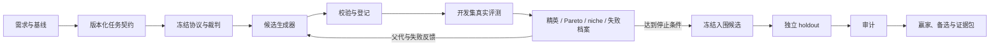
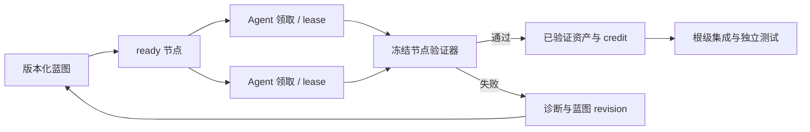

# Evidence Research Loop

Evidence Research Loop 是一个**证据驱动的工程方案进化系统**。它把“请 AI 给我一个好方案”转成可执行、可恢复、可审计的搜索过程：生成多个候选，用冻结的裁判实际运行，依据失败继续改进，最后在独立测试上比较并交付证据。

它不是新的基础模型，也不是只输出建议的聊天机器人。它是连接**任务契约、候选生成器、评测器、多代控制器、档案、独立测试和审计记录**的执行框架。

> 版本与内置 Skill 完整性以 [`version.json`](version.json) 为准；发布时由清单哈希固定，不在本文重复维护易失效的版本号。
>
> 它找到的是“在已声明搜索空间、裁判、数据和预算下，实际测试过的最好方案”，不等于数学意义上的全局最优。

## What：这个系统是什么

系统把一个开放问题转换成以下闭环：

1. 定义 solution、稳定接口和允许修改的范围；
2. 固定基线、硬门禁、指标、数据、资源和停止规则；
3. 由模型、Agent、脚本或其他生成器提出可执行候选；
4. 在隔离目录中运行真实测试，而不是让模型给自己打分；
5. 淘汰违反硬约束的候选，保留精英、Pareto、机制多样性和失败档案；
6. 把开发集上的失败证据反馈给下一代；
7. 达到预算或停止条件后冻结候选；
8. 在未用于调优的 holdout 上比较；
9. 独立审计运行矩阵、哈希、事件链、费用和结论。

候选可以是代码、算法、配置、Agent 工作流、业务策略或可执行实验方案。前提是它有明确产物、统一 workload 和可验证的验收条件。

## Who：适合谁

| 使用者或场景 | 适合解决的问题 |
| --- | --- |
| 软件团队 | 比较多个实现、算法、缓存、并发或架构方案 |
| Agent / 自动化团队 | 优化工作流、提示、工具选择和路由策略，并保存 trace |
| 数据与运筹团队 | 比较补货、排程、配置、资源分配或仿真策略 |
| 研究人员 | 管理假设、实验分支、分析和证据包；可选择 Scientist Mode |
| 审查者 | 从逐例记录和哈希独立重算，而不是只读最终报告 |

它不适合普通问答、单次小修、没有可执行产物的空泛创意，或无法定义验收证据的问题。生产发布、真实订单和不可逆操作也不会被搜索结果自动授权。

## Why：为什么需要它

一次性让模型“设计最优方案”通常缺少统一裁判、失败留痕、多方案比较和未见数据验证。Evidence Research Loop 把模型从“结论提供者”改成“候选生成者”，把判断交给实际运行的测试和证据。

它重点防止：候选从未运行；生成器看到隐藏答案；失败被覆盖；恢复时重复调用或漏掉已落盘结果；把失败惩罚误写成实际耗时；把重复 holdout 称为新独立测试；把公开赢家复跑称为自主发现；把有限样例通过扩大成完整兼容。

## 借鉴了什么

本项目是方法抽象和工程实现，不是 ShinkaEvolve 或 AI Scientist-v2 的官方 fork，运行时也不依赖它们。

| 来源 | 借鉴的思想 | 本系统中的实现 |
| --- | --- | --- |
| ShinkaEvolve | 程序种群、变异/组合、适应度、档案/岛屿、文本反馈 | 候选谱系、生成角色、冻结 evaluator、精英/Pareto/niche/失败档案、失败驱动 repair |
| AI Scientist-v2 | 假设形成、实验分支、分析和研究产物组织 | 可选 Scientist Mode，用相同的冻结、独立测试和审计门禁编排研究 |
| Prove2Me | 不可变主张/提交分离、条件归约、多条证明路径、资产复用 | Composition Graph 的 Claim、Reduction、实际子产物绑定和工程验收；独立实现公开方法，没有打包其 workspace，不等同完整平台复现 |
| Goedel-Architect | 蓝图 DAG、并行节点验证、结构化失败和失败驱动重构 | Research Graph 的 ready queue、lease、验证器、split/rewire/invalidate 和恢复；当前通用实现为 clean-room 实现 |
| 软件与实验工程 | 可复现构建、独立测试、故障注入、审计与恢复 | 协议哈希、唯一 run ID、事件链、holdout 历史、逐例记录、进程树超时和证据清单 |

完整来源、固定版本和许可证边界见 [`references/design-influences.md`](evidence-research-loop/references/design-influences.md)。Prove2Me 的公开 workspace 当前没有明确许可证，公开可读不等于允许复制；Goedel-Architect 使用 Apache-2.0，但本项目当前没有复制其源码。

Scientist Mode 现在包含真实命令执行层：它会实际调用构想、文献、实验、分析和独立评审适配器，保存每次请求、响应、原始输出、耗时、费用与哈希，并从证据派生是否接受。专项测试验证的是这些运行与审计约束；它仍不能证明五个模块各自具有独立实证贡献，也不能自动证明某个模型具备 AI Scientist-v2 等级的科研能力。后者必须在未预制答案的真实任务上另行验收。

## 已完成的真实验收

- [`demos/scientist-runtime-backoff-v1`](demos/scientist-runtime-backoff-v1/README.md)：
  真实执行五阶段 command，在冻结协议下生成并保存 12,000 条逐例观察，analysis
  与独立 review 分别复算；最终 audit 为 `valid: true / accepted: true`。该实验
  使用确定性仿真、模型调用为 0，因此验证运行与证据闭环，不验证模型创造力。
- [`demos/research-graph-kpi-v1`](demos/research-graph-kpi-v1/README.md)：
  四个独立 Agent turn 完成四节点 KPI 图。第一次根集成因依赖资产结构错误失败，
  失败证据被保留；revision 2 只重开失败节点，最终四节点全部 verified，图 audit
  为 `valid: true / accepted: true`。这验证节点协作、失败修复和资产复用，不代表
  KPI 政策已满足公平性或生产审批。

两项演示都允许另一位审查者从原始记录重新计算。它们是当前实现的能力证据，
不是对跨领域泛化、全自动问题分解或 AI Scientist-v2 等级科研能力的证明。

## How：系统怎样运行

### 组合图：把模块结果组成完整系统

普通 Research Graph 管理任务领取与依赖调度。新增的 **Composition Graph** 管理主张是否有足够证据成立：同一目标可以有多条替代路径，每条组合路径必须满足全部前提。

运行顺序是：冻结 Claim 和裁判 → 提交组合产物并检查条件 → 验证子模块 → 显式绑定每个子模块的不可变 evidence ID → 用真实子产物执行组合和集成 → 根目标通过固定 holdout → 审计。

`conditionally_validated` 只表示条件组合检查通过；子模块尚未完成、真实集成失败或 holdout 缺失时，目标不会接受。撤销证据只使依赖它的路径失效，其他有效路径仍可保留。资产导入检查原始来源和精确契约，并在目标项目重新运行裁判。检索目前为文字检索，不把语义相似当成复用许可。

本版保证类别为 `empirical`，只支持声明契约和测试范围内的工程验收；拒绝将其标为 `formal`。人审和盲回译接口记录外部提交的声明，不能自行认证审查者身份或证明上下文隔离。完整用法见 [Composition Graph](evidence-research-loop/references/composition-graph.md)。

本地 CLI：

```powershell
python evidence-research-loop/scripts/composition_graph.py init <项目目录> <composition-blueprint.json>
python evidence-research-loop/scripts/composition_graph.py submit <项目目录> <提交请求.json>
python evidence-research-loop/scripts/composition_graph.py audit <项目目录>
```

MCP 使用 `create_project(template="composition-graph")`、`initialize_composition_graph`、`submit_composition`、`get_composition_status`、`audit_composition_graph`；恢复、撤销、资产导出/导入及 read-back/milestone 有对应专用工具。模板是已知配置的基础设施冒烟，不能作为自主研究或未见数据泛化成果。

以下是外层方案搜索流程，与组合图可配合使用：



当一个候选本身太大、需要多个 Agent 协作时，再在候选内部启用 Research Graph：



外层候选谱系回答“哪一种整体方案更好”；内层 Research Graph 回答“怎样让多个 Agent 可恢复地完成同一个复杂方案”。节点通过不能替代根级集成、holdout 或人工门禁。

生成器只获得公开任务说明、父代和开发反馈。完整裁判、内部契约和 holdout 由评测侧管理，不复制到 generator workspace。最终是否接受由 `audit_project` 判断；`completed` 只表示预期执行结束，不自动等于 `accepted: true`。

### 核心组件

| 组件 | 职责 |
| --- | --- |
| Skill | 帮助 Codex 定义问题、契约、候选机制、证据边界和结论范围 |
| `evolution_controller.py` | 执行可恢复的生成、评测、选择、冻结和 holdout 状态机 |
| `research_graph.py` | 执行节点 DAG、原子领取、lease/heartbeat、失败重构、资产复用和 node-level credit |
| `scientist_runtime.py` | 实际运行构想、文献、实验、分析、评审适配器，并生成受证据约束的研究包 |
| Task adapter | 把具体领域转成统一的候选、输入、裁判和指标 |
| Evaluator | 输出硬门禁、指标、行为签名、耗时和原始记录 |
| Archive | 保存精英、Pareto、机制 niche、失败类别和相似组 |
| MCP Server | 把创建、上传、启动、恢复、状态、审计和导出封装成工具 |
| Evidence store | 保存协议锁、事件链、谱系、逐例结果、冻结记录和报告 |

### 多代搜索和恢复

每个 generation/slot 都有稳定 request ID。控制器先保存请求和 `generation_started`，调用完成后写入哈希链接的事件链，再更新状态。恢复时：

- 已完成的请求不会重复调用；
- 已完整落盘的响应会先登记和评测，再判断剩余预算；
- 结果未知的调用标为 abandoned，不自动重复计费；
- holdout 缺少哪个“候选 × 重复次数”格，就只补哪个；
- 已完成任务只重建报告，不重复写终态事件。

外部命令受剩余 wall-time 限制。超时会终止整个进程树。非零退出、超时、非法输出和缺失结果都明确判为失败，不能接受旧目录中的残留成功文件。

## 新任务如何开发

新领域通常只增加任务目录，不修改控制器：

```text
my-search/
├─ task.json          # solution、生成器、预算、选择和完整评测契约
├─ brief.md           # 生成器可以读取的公开需求
├─ baseline.py        # 或 baseline.json：真实基线
├─ evaluator.py       # 独立裁判
├─ seeds.json         # dev / holdout 标识
└─ fixtures/          # 正确、边界、错误和机制不同的测试候选
```

`task.json` 需要明确：artifact 和稳定接口、mutable boundary、hard gates、objective vector、workload、behavior signature、generator、budget 和 selection。Evaluator 应先经过正确、错误、边界和超时候选的故障测试；结果至少保存 hard-pass、原始目标向量、失败类别、行为签名、实际耗时、计分值和原始输出，不能只返回一个无法复算的综合分。

### 候选生成后端

- `deterministic`：用预制候选测试控制器；不能证明自主搜索能力；
- `command`：接入按约定写出响应和候选文件的 Agent 或脚本；
- `codex`：底层控制器可调用本机 Codex CLI，使用只读生成 workspace 和结构化响应；
- `docker-command`：用固定镜像、资源限制和最小挂载提供更强隔离。

当前 MCP 声明内置可用的是 `deterministic` 和 `command`。它不内置 Codex CLI 或付费模型密钥。真实模型搜索需要运行环境另外提供生成后端、凭据、预算和网络策略。

## Skill、本地 MCP 和云端 MCP

| 方式 | 文件位置 | 适合场景 | 特点 |
| --- | --- | --- | --- |
| 直接调用本地 Skill | 当前 Codex 工作区 | 探索需求、建立契约、协作开发 | Codex 按方法执行脚本，灵活度最高 |
| `evidence-research-loop-local` | 本机 MCP 项目目录，或 allowlist 内的项目 | 本地代码、多代搜索、正式审计 | 用标准工具强制项目、恢复和审计流程 |
| `evidence-research-loop-cloud` | Azure 持久化 `/data/projects` | 长任务、远程恢复、共享执行环境 | 不能直接读客户机文件，必须上传 |

三者使用同一套打包引擎，具体版本见 `version.json`。入口不同：Skill 是“怎样研究和设计”；MCP 是“怎样创建、运行、恢复和审计项目”。

## MCP 标准调用顺序

```text
get_capabilities
  → create_project / attach_local_project（仅本地）
  → write_files
  → validate_project
  → start_search
  → get_status
  → resume_search（需要时）
  → audit_project
  → finalize_evidence
```

当前 29 个工具分为三组：

- 能力与项目：`get_capabilities`、`list_projects`、`attach_local_project`、`create_project`；
- 文件：`write_files`、`list_files`、`read_file`；
- 外层搜索：`validate_project`、`start_search`、`resume_search`、`get_status`、`audit_project`、`finalize_evidence`；
- Research Graph：`initialize_research_graph`、`claim_research_node`、`heartbeat_research_node`、`submit_research_node`、`fail_research_node`、`reuse_research_asset`、`revise_research_graph`、`resume_research_graph`、`get_research_graph_status`、`audit_research_graph`；
- Scientist Runtime：`validate_scientist_project`、`start_scientist_study`、`resume_scientist_study`、`get_scientist_status`、`audit_scientist_project`、`export_scientist_report`。

`start_search` 和 `resume_search` 立即返回 job ID；用 `get_status` 查询后台任务。只有 `audit_project` 才判断证据是否有效、结果是否接受。

## 不经过 MCP 的快速开始

```powershell
py -3.13 -m venv .venv
.\.venv\Scripts\python -m pip install -r requirements-dev.txt
$controller = 'evidence-research-loop\scripts\evolution_controller.py'
.\.venv\Scripts\python $controller scaffold python-code C:\work\my-search
# 编辑 task.json、brief.md、baseline.py、evaluator.py 和 seeds.json
.\.venv\Scripts\python $controller validate C:\work\my-search
.\.venv\Scripts\python $controller start C:\work\my-search
.\.venv\Scripts\python $controller status C:\work\my-search
.\.venv\Scripts\python $controller resume C:\work\my-search
.\.venv\Scripts\python $controller export C:\work\my-search
```

`python-code` 和 `json-strategy` 是外层候选搜索模板。旧 `scientist-mode` 仍保留为控制器兼容性冒烟测试，它的预设评分不能作为科研证据。真实科研使用 `scientist_runtime.py` 和 `research-plan.json`；多 Agent 拆解使用 `research_graph.py` 和 blueprint。`assets/task-templates/scientist-runtime` 与 `assets/task-templates/research-graph` 只提供适配器契约和安全失败的骨架，必须接入真实来源、实验与验证器后才能运行正式任务。

### Research Graph 快速开始

```powershell
$graph = 'evidence-research-loop\scripts\research_graph.py'
python $graph init C:\work\graph-project C:\work\blueprint.json
python $graph claim C:\work\graph-project --worker agent-a --lease-seconds 900
# Agent 生成产物后，使用 claim 返回的 node_id 与 lease_token：
python $graph execute C:\work\graph-project <node-id> C:\work\artifact.zip `
  --worker agent-a --token <lease-token> `
  --contributor-kind agent --contributor-id agent-a --model <model>
python $graph status C:\work\graph-project
python $graph audit C:\work\graph-project
```

多个 Agent 可并行执行 `claim`；返回值只公开当前节点及其直接依赖的已验证资产。领取操作使用文件锁和 lease 防止重复分配，过期 lease 不能续租或提交。事件只保存 token 指纹，不保存授权 token。节点失败后先保存失败，再提交版本化 revision 做 `split`、`rewire`、`supersede` 或 `invalidate`；替换依赖会递归使下游证据失效。不能删除失败记录来重写历史。

verifier 命令引用的本地文件会在初始化时冻结哈希；额外导入文件用 `verifier.frozen_files` 显式登记。执行前与审计时都会复核这些文件，子进程只接收最小环境加 `env_allowlist`。资产复用要求 statement、直接依赖资产、输出契约、verifier 契约和 scope 全部一致，不能只因 JSON 形状相同就跨任务复用。

### Scientist Runtime 快速开始

```powershell
$scientist = 'evidence-research-loop\scripts\scientist_runtime.py'
# 先创建 research-plan.json，并把五个 stage command 接到真实适配器
python $scientist validate C:\work\scientist-project
python $scientist start C:\work\scientist-project
python $scientist status C:\work\scientist-project
python $scientist resume C:\work\scientist-project
python $scientist audit C:\work\scientist-project
python $scientist export C:\work\scientist-project
```

每个 stage command 收到 `{request}`，必须把 JSON 写到 `{response}`；实验原始文件写到本次 `{attempt_dir}` 并由 `evidence_files` 引用。运行时会拒绝命令对协议和既有证据的修改，把缺少真实实验文件的“passed”实验标为不能支持主张，并把没有来源却自称新颖的结果降级为 `unknown`。项目级写锁防止并发 start/resume 覆盖状态；审计把协议锁、初始化事件、attempt result、stage output、原始实验文件及派生 ledger 交叉核验。`completed` 只表示阶段执行完；最终结论同时检查 `audit.valid` 与报告中的 `acceptance.accepted`。

## 证据和安全边界

系统保存 `search-state.json`、哈希链接的 `search-events.jsonl`、每次 generator 请求/响应、候选谱系、精英/Pareto/失败档案、独立 `runs-v2/<run-id>`、协议锁、冻结版本、不可清除的 holdout 访问历史、最终报告和 evidence manifest。

要声明新独立测试，必须先把 seed、样本 ID、时间窗或来源键与历史记录求交；发生重叠时只能标为回归复测。同一 seed 的重复运行只用于估计波动，不计作新的独立问题。

- Azure 服务只读写自己的持久化项目目录，不能直接访问用户电脑；
- 本地服务只能 attach `ERL_LOCAL_ALLOWED_ROOTS` 明确允许的目录；
- 搜索和 evaluator 进程使用 UID/GID `20000` 和清理后的环境；
- 子进程不继承 MCP bearer token 或 Azure secret；
- Graph verifier 与 Scientist stage 的 `command` 都是可信任务作者可配置的任意代码执行接口；云端仅适合持有 bearer token 的可信调用者，并依赖非 root 容器边界。对不受信任租户必须再加独立容器、命令 allowlist 和网络/文件系统隔离；
- 每次执行使用独立 run ID；候选不能修改冻结裁判、协议或数据；
- Azure Files 使用共享卷兼容权限，但候选仍以非 root 身份执行。

## 已知边界

- 系统不会自动保证自然语言需求能形成可靠 evaluator；裁判必须先验证；
- 有限预算的赢家不是全局最优；没有收益时应保留基线；
- 公开赢家只能作为正对照，不能冒充当前搜索自主发现；
- 测试集通过只证明该测试集通过，不能自动外推为完整标准兼容；
- 第一版候选接口以单文件产物为主；多文件软件可使用补丁、归档或生成配置；
- 云端未配置模型后端时，只能运行确定性或已有命令流程；
- Research Graph 与 Scientist Runtime 的调度、恢复、账本和证据约束已有自动测试；跨进程、多主机和大规模协作的稳定性仍需真实负载验证；
- Scientist Mode 的科研质量、五模块必要性、模型创造力和跨领域泛化仍待未预制答案的真实实验；
- Research Graph 不会替 Agent 自动发现可靠分解；蓝图质量、节点 verifier 和根级集成验收仍需针对任务设计；
- 节点 credit 表示可追溯贡献，不自动等于作者资格、知识产权归属、绩效分配或科学信用判断。

## 验证、部署和连接

```powershell
py -3.13 -m venv .venv
.\.venv\Scripts\python -m pip install -r requirements-dev.txt
.\.venv\Scripts\python tests/run_selftest.py
docker build -t evidence-research-loop-mcp:test .
```

`run_selftest.py` 统一运行 37 项引擎回归与 9 项 MCP 服务回归，不调用模型。
Windows/Codex 沙箱内请使用此入口：它为每次运行设置独立的 `ERL_TEST_TMP`，
使用工作区 `ai agent/.erl-test-tmp/<唯一 ID>`，避免系统 Temp 的继承权限拒绝写入，
也缩短生成文件路径。无须关闭沙箱、修改系统 Temp ACL 或以管理员权限运行。
该入口当前按本仓库工作区布局定位短路径（MCP 目录的第三层父目录）。
每轮的协议、源码哈希、原始 stdout/stderr、退出码、耗时、汇总及哈希清单
保存在新的 `test-output/selftest/<时间戳-唯一 ID>/`；失败运行同样保留。
直接运行 `unittest discover` 不会自动设置此环境变量，不能视为相同的测试入口。

MCP 使用 Streamable HTTP `/mcp`。`/healthz` 不要求认证，只返回版本和引擎完整性。生产端点：

```text
https://evidence-research-loop-mcp.nicetree-1d19d2fd.eastus.azurecontainerapps.io/mcp
```

本机 `~/.codex/config.toml` 已注册 `evidence-research-loop-local` 和 `evidence-research-loop-cloud`。安装或更新环境变量后需要完全重启 Codex。Bearer token 不存入仓库。Azure 镜像 digest、存储、持久化验证和复核命令见 [`deployment/README.md`](deployment/README.md)。

## 许可状态

仓库当前没有根级开源许可证。公开可读不等于自动获得复制、修改或再分发授权；
在仓库所有者明确选择许可证前，应视为 source-available。第三方来源继续分别遵循
其原许可证、使用条款和引用要求。

